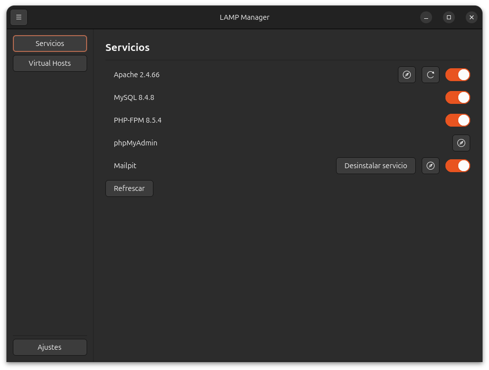
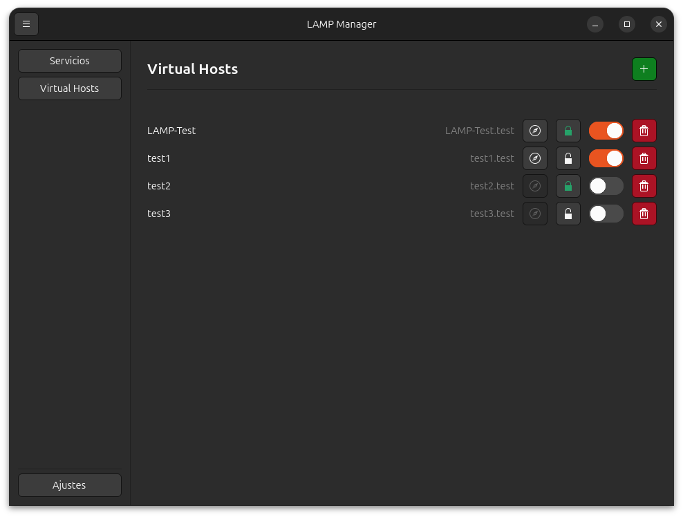
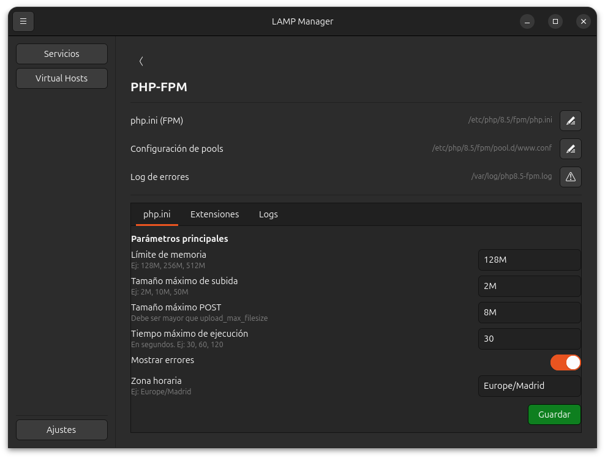
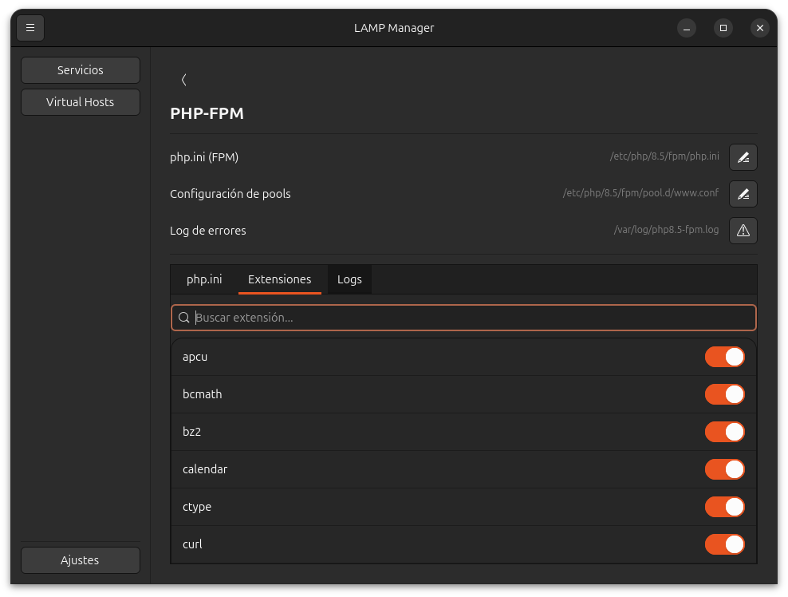
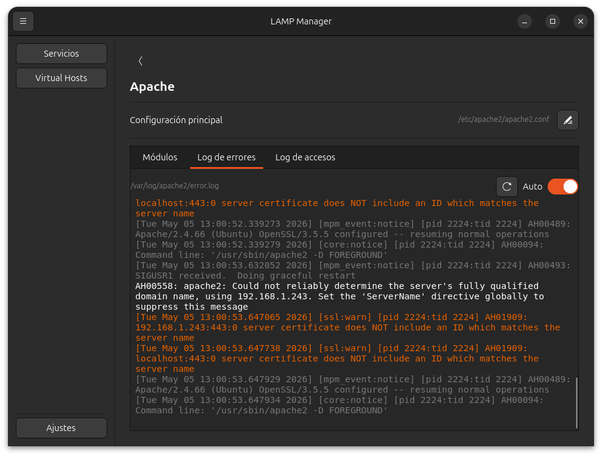
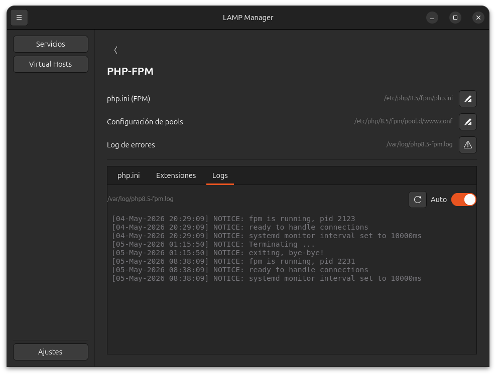

# LAMP Manager

A GTK4 graphical application to manage your LAMP stack on GNOME desktops. Start and stop services, manage Apache virtual hosts, configure PHP, and monitor logs — all without touching the terminal.

> Designed for Ubuntu/Debian developers who work with Apache, MySQL and PHP-FPM on a daily basis.

---

## Features

- **Service control** — Start and stop Apache, MySQL and PHP-FPM with a single toggle
- **Port monitoring** — See which ports each service is currently listening on
- **Virtual host management** — Create, enable, disable and delete Apache virtual hosts
- **PHP configuration** — Edit `php.ini` parameters directly from the UI
- **Log viewer** — Browse service logs with color-coded severity levels
- **Mailpit integration** — Install, configure and control the Mailpit email testing service
- **phpMyAdmin shortcut** — Quick access to phpMyAdmin in the browser
- **Recommendations panel** — Warns you about recommended services that are not installed
- **Apache + PHP-FPM warning** — Alerts you when Apache is running but PHP-FPM is not, which would break PHP projects

---

## Screenshots

### Services


### Virtual hosts


### PHP configuration


### PHP extensions


### Log viewer



---

## Requirements

- Ubuntu 24.04 (Noble Numbat) or later, or any GNOME-based Debian derivative
- Python 3.10 or later
- GTK 4 (`gir1.2-gtk-4.0`)
- PyGObject (`python3-gi`)
- `gvfs-backends` (for filesystem operations)
- `sudo` access (required to manage systemd services)

**Recommended services** (the application manages these, but does not require them to launch):

- `apache2`
- `php-fpm` (any version)
- `default-mysql-server` or `mysql-server`

---

## Installation

### Option 1 — PPA (recommended)

```bash
sudo add-apt-repository ppa:nefreyu-99/lamp-manager
sudo apt update
sudo apt install lamp-manager
```

### Option 2 — Download the .deb package

Download the latest `.deb` from the [Releases page](https://github.com/Nefreyu/lamp-manager/releases) and install it:

```bash
sudo dpkg -i lamp-manager_0.1.2_all.deb
sudo apt-get install -f   # installs any missing dependencies
```

### Option 3 — Run from source

Clone the repository and run directly with Python:

```bash
git clone https://github.com/Nefreyu/lamp-manager.git
cd lamp-manager

# Install system dependencies
sudo apt install python3-gi gir1.2-gtk-4.0 gvfs-backends

# Run
python3 main.py
```

No virtual environment or pip packages are needed — the application relies entirely on system packages.

---

## Usage

Launch LAMP Manager from your application menu or run:

```bash
lamp-manager
```

### Services tab

The main screen shows all detected services. Each row displays:

- The service name and version
- The ports it is currently using
- A toggle switch to start or stop it
- A browser button (for services with a web interface)
- A reload button (for Apache, to apply configuration changes without a full restart)

If Apache is active but PHP-FPM is not, a warning banner appears at the top with a one-click fix.

### Virtual hosts

The **Virtual Hosts** section lets you manage Apache site configurations:

- Create new virtual hosts with a name and document root
- Enable or disable existing sites (`a2ensite` / `a2dissite`)
- Delete site configuration files

### PHP configuration

The **PHP** section allows you to modify common `php.ini` values (memory limit, upload size, execution time, etc.) through a form, without having to locate and edit the file manually.

### Log viewer

The **Logs** section displays systemd journal entries for each service. Log lines are color-coded by severity:

| Color | Level |
|-------|-------|
| Red | Error / Critical |
| Orange | Warning |
| Gray | Debug / Info |

### Mailpit

[Mailpit](https://github.com/axllent/mailpit) is an email testing tool for local development. LAMP Manager lets you:

- Install and uninstall Mailpit as a systemd service
- Configure storage and SMTP settings
- Open the Mailpit web UI directly from the services list

---

## Project structure

```
lamp-manager/
├── main.py                  # Entry point
├── windows/
│   ├── main_window.py       # Main application window
│   └── password_dialog.py   # sudo password dialog
├── pages/
│   ├── servicios.py         # Services overview
│   ├── vhosts.py            # Virtual host management
│   ├── php_config.py        # PHP configuration
│   ├── log_viewer.py        # Log viewer
│   ├── mailpit_config.py    # Mailpit settings
│   ├── mysql_config.py      # MySQL information
│   ├── apache_config.py     # Apache information
│   └── ajustes.py           # Application settings
├── services/
│   ├── systemd.py           # systemd service control
│   ├── apache.py            # Apache-specific helpers
│   ├── mysql.py             # MySQL-specific helpers
│   ├── php.py               # PHP-specific helpers
│   ├── vhosts.py            # Virtual host file management
│   └── recommendations.py   # Missing service detection
├── config/
│   └── settings.py          # Persistent settings
├── data/
│   └── io.github.nefreyu.LampManager.metainfo.xml
├── packaging/
│   └── io.github.nefreyu.LampManager.desktop
└── debian/                  # Debian packaging files
```

---

## How it works

LAMP Manager uses standard Linux tools under the hood:

- **systemd** (`systemctl`) — to start, stop, enable and check service status
- **ss** — to detect which ports each service is listening on
- **a2ensite / a2dissite** — to manage Apache virtual hosts
- **journalctl** — to read service logs
- **sudo** — for privileged operations; the application asks for your password when needed

No daemons, no background processes, no polling — everything is read on demand.

---

## Contributing

Contributions are welcome. To get started:

1. Fork the repository
2. Create a branch: `git checkout -b my-feature`
3. Make your changes and test them
4. Open a pull request

Please keep commits focused and write clear commit messages. There are no automated tests yet, so manual testing against a real LAMP environment is expected.

---

## License

LAMP Manager is free software released under the [GNU General Public License v3.0](LICENSE).

Copyright © 2026 Juan Diez
